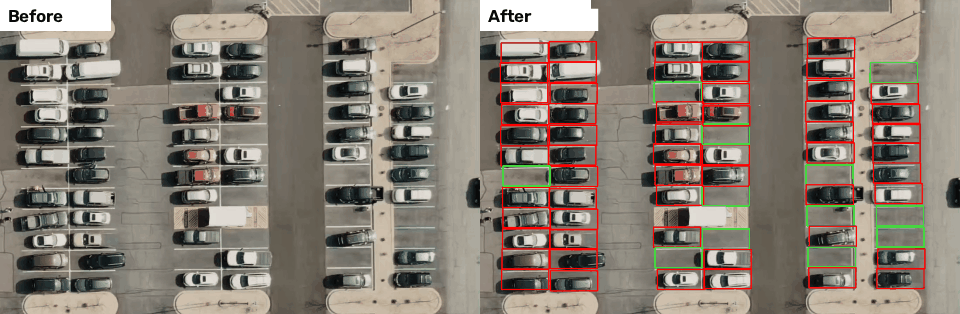

# OpenCV Computer Vision Examples

[](https://www.python.org/)
[](https://opencv.org/)
[](LICENSE)

A collection of small, self-contained Python scripts that walk through core
computer vision techniques with OpenCV, from reading an image to detecting
license plates and counting free parking spots.

Each script does one thing, has a short docstring, and keeps its tunable values
(thresholds, kernel sizes, ...) as named constants at the top.

## Contents

| Folder | Topic | Scripts |
| --- | --- | --- |
| [`01_basics`](examples/01_basics) | Reading images, videos and the webcam | `read_image`, `read_video`, `read_webcam` |
| [`02_image_manipulation`](examples/02_image_manipulation) | Color spaces and geometric operations | `color_spaces`, `crop`, `resize`, `rotate`, `flip` |
| [`03_histograms`](examples/03_histograms) | Histograms and contrast enhancement | `histogram`, `contrast_stretching`, `histogram_equalization` |
| [`04_filtering`](examples/04_filtering) | Blurring and sharpening | `box_blur`, `gaussian_blur`, `median_blur`, `sharpen` |
| [`05_edge_detection`](examples/05_edge_detection) | Gradient and edge detectors | `sobel`, `canny` |
| [`06_morphology`](examples/06_morphology) | Erosion, dilation, closing | `erosion`, `dilation`, `closing_with_canny` |
| [`07_perspective_transform`](examples/07_perspective_transform) | Warping to a top-down view | `warp_perspective`, `warp_with_mouse_clicks` |
| [`08_contours_and_shapes`](examples/08_contours_and_shapes) | Contours and shape classification | `find_contours`, `shape_detection` |
| [`09_object_detection`](examples/09_object_detection) | Haar cascades and counting objects | `face_detection_image`, `face_detection_webcam`, `coin_counting` |
| [`10_projects`](examples/10_projects) | Small end-to-end projects | `document_scanner`, `license_plate_cascade`, `license_plate_contours`, `parking_position_finder`, `parking_space_counter`, `make_parking_demo_gif` |

## Getting started

**Requirements:** Python 3.9+ and a desktop environment (the scripts open
windows with `cv2.imshow`, so they won't run on a headless server). Two
examples need a webcam.

```bash
git clone https://github.com/20armin04/opencv-computer-vision-examples.git
cd opencv-computer-vision-examples

python -m venv .venv
source .venv/bin/activate        # Windows: .venv\Scripts\activate
pip install -r requirements.txt
```

The examples read their inputs from [`data/`](data). See
[`data/README.md`](data/README.md) for the list of expected image and video
files.

## Usage

Run any script directly; it works from any directory:

```bash
python examples/02_image_manipulation/rotate.py
python examples/09_object_detection/coin_counting.py
```

- Image windows close on any key press.
- Video and webcam windows close with **q**.

### Parking space counter



This project has two steps:

1. Mark the parking spots on a still frame (left-click adds a spot, right-click
   removes one). Spots are saved to `parking_positions.json`:
   ```bash
   python examples/10_projects/parking_position_finder.py
   ```
2. Count the free spots in the video (green = free, red = occupied):
   ```bash
   python examples/10_projects/parking_space_counter.py
   ```

A set of spots for the sample footage is already included.

To regenerate the demo GIF above from your own footage:

```bash
python examples/10_projects/make_parking_demo_gif.py
```

## Project structure

```
.
├── data/
│   ├── images/
│   └── videos/
├── docs/
├── examples/
│   ├── 01_basics/
│   ├── 02_image_manipulation/
│   ├── 03_histograms/
│   ├── 04_filtering/
│   ├── 05_edge_detection/
│   ├── 06_morphology/
│   ├── 07_perspective_transform/
│   ├── 08_contours_and_shapes/
│   ├── 09_object_detection/
│   └── 10_projects/
├── LICENSE
├── README.md
└── requirements.txt
```

## Notes

- Thresholds and kernel sizes are tuned for the sample images and videos. Expect
  to adjust them for your own data.
- `license_plate_cascade.py` uses the Haar cascade bundled with OpenCV, which was
  trained on Russian plates. `license_plate_contours.py` is a cascade-free
  alternative based on contour shape and aspect ratio.
- Haar cascades are a classic technique and are less accurate than modern deep
  learning detectors; they are used here to teach the fundamentals.

## License

Released under the [MIT License](LICENSE).

<!-- Credit any course, tutorial or dataset these examples are based on here. -->
